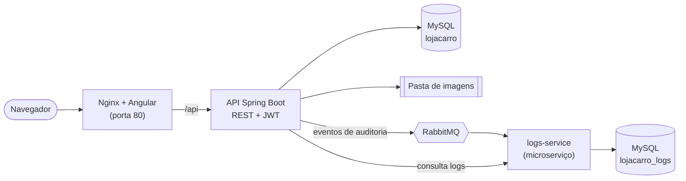

# LojaCarro — Loja de veículos com agendamento de test drive

Trabalho final da disciplina: sistema web para uma concessionária divulgar seu catálogo de seminovos e receber
agendamentos de test drive.

## 1. Descrição do sistema

- **Catálogo público:** visitantes consultam os veículos disponíveis, com foto, preço, ano, quilometragem e
  características. Podem buscar por marca/modelo e filtrar por faixa de preço e ano.
- **Clientes:** criam conta, fazem login e **agendam test drives de 30 minutos** escolhendo um horário livre numa
  grade. Também consultam e cancelam os próprios agendamentos futuros.
- **Administradores:**
  - cadastram e gerenciam veículos, com upload da fotografia;
  - marcam veículos como vendidos ou os desativam (exclusão lógica);
  - consultam todos os agendamentos por data e veículo, cancelando ou registrando os realizados;
  - veem os clientes e os logs de auditoria.
- **Regra principal:** um veículo nunca tem dois agendamentos confirmados em horários coincidentes. A verificação é
  feita no backend, com bloqueio no banco, e vale mesmo quando dois clientes tentam o mesmo horário ao mesmo tempo.
- **Auditoria:** todas as operações são enviadas por **RabbitMQ** a um **microserviço de logs** separado.

## 2. Tecnologias utilizadas

| Componente | Tecnologia |
|---|---|
| Backend | Java 17, Spring Boot 3.5 (Web, Data JPA, Security, Validation, AMQP) |
| Autenticação | JWT (biblioteca jjwt), senhas com BCrypt |
| Banco de dados | MySQL 8.4, versionado com Flyway |
| Mensageria | RabbitMQ 4.1 (microserviço de logs) |
| Frontend | Angular 21, Angular Material, RxJS, signals |
| Documentação da API | Swagger / OpenAPI (springdoc) |
| Testes backend | JUnit 5, Mockito, Spring Boot Test, MockMvc, H2, JaCoCo |
| Testes frontend | Vitest (com cobertura v8) |
| Infraestrutura | Docker, Docker Compose, Nginx, GitHub Actions |
| Publicação | AWS EC2 |

## 3. Arquitetura da aplicação



- A API é organizada em camadas: `controllers` (DTOs), `services` (regras de negócio), `repository`, `model`,
  `security`, `mensageria` e `exception`.
- O frontend é dividido em `core` (models, services, guards, interceptors), `shared` e `pages`.

**Documentação completa:**
- [Arquitetura e fluxos](docs/ARQUITETURA.md)
- [Diagrama entidade-relacionamento](docs/DER.md)
- [Endpoints REST](docs/API.md)
- [Testes](docs/TESTES.md)
- [Publicação](docs/DEPLOY.md)

### Estrutura do repositório

```
.
├── src/                      API (Spring Boot)
├── logs-service/             Microserviço de logs (Spring Boot + RabbitMQ)
├── frontend/                 Interface (Angular)
├── docker/mysql/init/        Script que cria o banco do microserviço de logs
├── docker-compose.yml        MySQL + RabbitMQ para desenvolvimento
├── docker-compose.prod.yml   Sistema completo para publicação
└── docs/                     Arquitetura, DER, API, testes e deploy
```

## 4. Executar o backend

**Pré-requisitos:** Java 17+, Docker.

```bash
# 1. Banco de dados e RabbitMQ
docker compose up -d

# 2. Microserviço de logs (porta 8081)
./mvnw -f logs-service/pom.xml spring-boot:run

# 3. API (porta 8080), em outro terminal
./mvnw spring-boot:run
```

No Windows, use `mvnw.cmd` no lugar de `./mvnw`.

- Sem variáveis de ambiente, os dois serviços usam o perfil `dev`, já configurado para o `docker-compose.yml`.
- Na primeira execução, o Flyway cria as tabelas e são criados o administrador e o cliente de demonstração.
- Swagger: http://localhost:8080/swagger-ui.html
- Painel do RabbitMQ: http://localhost:15672 (`lojacarro` / `lojacarro`)

## 5. Executar o frontend

**Pré-requisito:** Node.js 22.12+ ou 24+.

```bash
cd frontend
npm install
npm start
```

Acesse http://localhost:4200. O `ng serve` encaminha `/api` para a API na porta 8080 (`proxy.conf.json`).

## 6. Configuração do banco de dados

- **MySQL 8.4** com dois bancos: `lojacarro` (API) e `lojacarro_logs` (microserviço de logs).
- **Desenvolvimento:** o `docker-compose.yml` sobe o MySQL com o usuário `lojacarro`. O banco `lojacarro_logs` é
  criado pelo script [`docker/mysql/init/01-criar-banco-logs.sh`](docker/mysql/init/01-criar-banco-logs.sh).
- **Criação das tabelas:** é feita pelo **Flyway** quando cada serviço inicia. Os scripts são:
  - [`V1__criar_tabelas.sql`](src/main/resources/db/migration/V1__criar_tabelas.sql)
  - [`V2__mover_logs_para_microservico.sql`](src/main/resources/db/migration/V2__mover_logs_para_microservico.sql)
  - [`logs-service/.../V1__criar_tabela_log_auditoria.sql`](logs-service/src/main/resources/db/migration/V1__criar_tabela_log_auditoria.sql)
- **Restrições:** as tabelas têm chaves estrangeiras, `UNIQUE` e `CHECK`, descritas no [DER](docs/DER.md).
- **Banco limpo:** para recomeçar do zero em desenvolvimento, `docker compose down -v` e depois `docker compose up -d`.

## 7. Variáveis de ambiente

Senhas, segredos e endereços vêm de variáveis de ambiente, e nenhum segredo de produção fica no código. Modelos
prontos: [`.env.example`](.env.example) (desenvolvimento) e [`.env.prod.example`](.env.prod.example) (publicação).

| Variável | Uso | Padrão no perfil `dev` |
|---|---|---|
| `DB_URL` | JDBC do banco da API | `jdbc:mysql://localhost:3306/lojacarro` |
| `LOGS_DB_URL` | JDBC do banco do microserviço | `jdbc:mysql://localhost:3306/lojacarro_logs` |
| `DB_USERNAME` / `DB_PASSWORD` | Usuário do MySQL | `lojacarro` / `lojacarro` |
| `JWT_SECRET` | Chave de assinatura dos tokens (mín. 32 caracteres) | valor de desenvolvimento |
| `JWT_EXPIRACAO_MINUTOS` | Validade do token | `120` |
| `ADMIN_EMAIL` / `ADMIN_SENHA` | Administrador criado na inicialização | `admin@lojacarro.local` / `admin123` |
| `DEMO_CLIENTE_EMAIL` / `DEMO_CLIENTE_SENHA` | Cliente de demonstração (opcional) | `cliente@lojacarro.local` / `cliente123` |
| `RABBITMQ_HOST` / `RABBITMQ_USERNAME` / `RABBITMQ_PASSWORD` | Conexão com o RabbitMQ | `localhost` / `lojacarro` / `lojacarro` |
| `LOGS_URL` / `LOGS_API_KEY` | Endereço e chave interna do microserviço de logs | `http://localhost:8081` / valor de desenvolvimento |
| `CORS_ORIGINS` | Origens do frontend permitidas | `http://localhost:4200` |
| `IMAGENS_DIR` | Pasta das fotografias | `img` |
| `AGENDA_ABERTURA` / `AGENDA_FECHAMENTO` / `AGENDA_FECHAMENTO_SABADO` | Horário da loja para test drives | `08:00` / `18:00` / `12:00` |
| `LOJA_FUSO_HORARIO` | Fuso da loja | `America/Fortaleza` |
| `SPRING_PROFILES_ACTIVE` | `dev` (padrão) ou `prod` (sem valores padrão para segredos) | `dev` |

## 8. Executar os testes

```bash
./mvnw test                               # API: 103 testes + cobertura em target/site/jacoco
./mvnw -f logs-service/pom.xml test       # Microserviço: 8 testes + cobertura
cd frontend && npm run test:cobertura     # Frontend: 35 testes + cobertura em frontend/coverage
```

Os testes do backend usam H2 em memória e não precisam de MySQL nem de RabbitMQ. Os cenários testados, os números
de cobertura e as evidências estão em [docs/TESTES.md](docs/TESTES.md). O GitHub Actions executa os três projetos a
cada push.

## 9. Endereço da aplicação publicada

> **A preencher após a publicação na AWS EC2:** `http://<IP-PUBLICO-DA-INSTANCIA>`
> (documentação da API em `http://<IP-PUBLICO-DA-INSTANCIA>/swagger-ui.html`)

O passo a passo da publicação está em [docs/DEPLOY.md](docs/DEPLOY.md).

## 10. Credenciais de demonstração

| Perfil | E-mail | Senha |
|---|---|---|
| Administrador | `admin@lojacarro.local` | `admin123` |
| Cliente | `cliente@lojacarro.local` | `cliente123` |

São as credenciais do ambiente de **desenvolvimento/demonstração** (perfil `dev`). No servidor publicado, as senhas
são definidas no arquivo `.env` da instância e não ficam no repositório.
