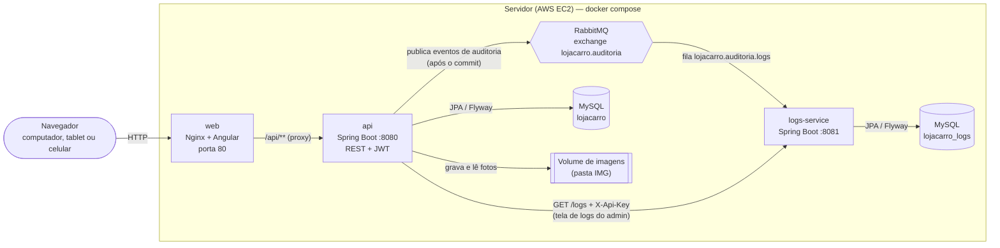
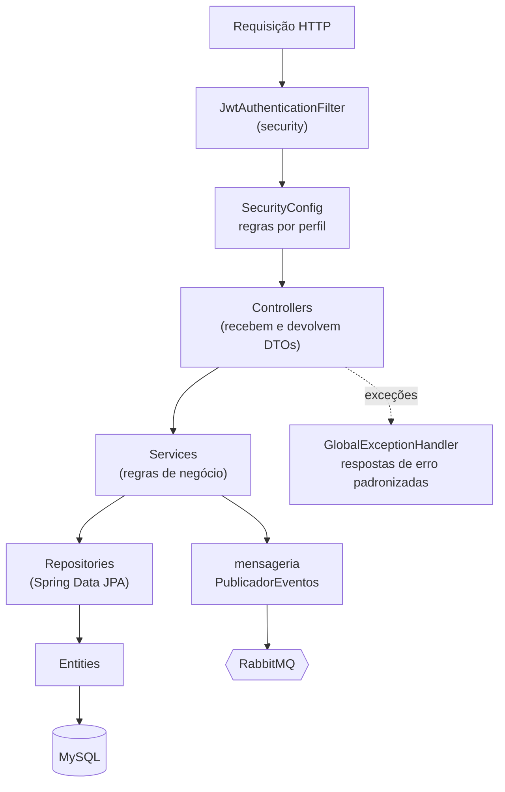
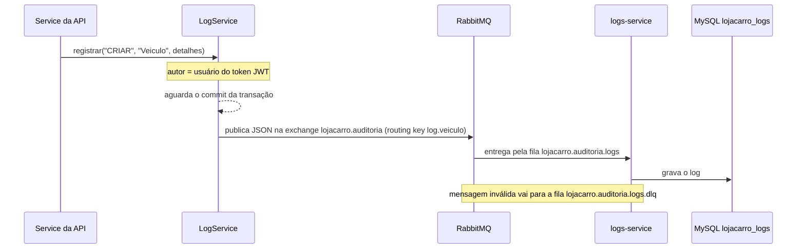

# Arquitetura

## Visão geral

| Componente | Tecnologia | Responsabilidade |
|---|---|---|
| **web** | Angular 21 + Angular Material, servido pelo Nginx | Interface. O Nginx entrega o Angular e encaminha `/api` para a API, então navegador e API ficam na mesma origem. |
| **api** | Java 17, Spring Boot 3.5, Spring Security, JPA, Flyway | Regras de negócio: veículos, fotos, usuários, autenticação JWT e agendamentos. |
| **logs-service** | Java 17, Spring Boot 3.5, Spring AMQP, JPA, Flyway | Microserviço de auditoria (RF07). Consome os eventos do RabbitMQ e os grava no seu próprio banco. |
| **RabbitMQ** | RabbitMQ 4.1 | Comunicação assíncrona entre a API e o microserviço de logs. |
| **MySQL** | MySQL 8.4 | Dois bancos independentes: `lojacarro` (API) e `lojacarro_logs` (microserviço). |

Na publicação, **somente o Nginx fica exposto** (porta 80). API, microserviço, banco e RabbitMQ só são acessíveis
pela rede interna do Docker.

## Camadas da API

| Pacote | Conteúdo |
|---|---|
| `controllers` | Endpoints REST. Só recebem e validam (`@Valid`) os DTOs e delegam para os services. |
| `services` | Regras de negócio: conflito de horário, validação das fotos, permissões por dono do recurso etc. |
| `repository` | Interfaces Spring Data JPA, consultas de sobreposição de horário e filtros (Specifications). |
| `model` | Entidades JPA e enums. |
| `dto` | Objetos de entrada e saída da API. As entidades nunca são expostas, então a senha não sai em nenhuma resposta. |
| `security` | JWT (geração e validação), filtro de autenticação, regras de acesso, CORS e BCrypt. |
| `mensageria` | Publicação dos eventos no RabbitMQ e cliente HTTP do microserviço de logs. |
| `exception` | Exceções de negócio e o `GlobalExceptionHandler` (400, 401, 403, 404, 409, 413, 422, 503). |
| `config` | Horário de funcionamento, relógio, Swagger e usuários iniciais. |

## Frontend (Angular)

| Pasta | Conteúdo |
|---|---|
| `core/models` | Tipos que espelham os DTOs da API. |
| `core/services` | Comunicação com a API e estado de autenticação (signals). |
| `core/interceptors` | Envio do token JWT, tratamento de sessão expirada e indicador de carregamento. |
| `core/guards` | Proteção das rotas por perfil (visitante, cliente e administrador). |
| `shared` | Componentes e pipes reutilizáveis (card de veículo, chips de situação, diálogos). |
| `pages` | Telas públicas, do cliente e do administrador. |
| `app.routes.ts` | Rotas, carregadas sob demanda. |

## Fluxos principais

### Autenticação (JWT)

1. `POST /api/auth/login` confere e-mail e senha (BCrypt) e devolve um token JWT assinado (HS256), com validade de
   120 minutos por padrão.
2. O frontend guarda o token e o envia em `Authorization: Bearer <token>` em todas as chamadas (`authInterceptor`).
3. Na API, o `JwtAuthenticationFilter` valida assinatura, emissor e validade, e recarrega o usuário do banco.
   O `SecurityConfig` aplica as regras por perfil (`ADMIN`/`CLIENTE`).
4. Sem token, ou com token inválido, a resposta é **401**. Com perfil sem permissão, **403**. As duas situações
   ficam registradas na auditoria.

### Agendamento de test drive sem conflitos

1. O cliente escolhe data e horário. A grade `GET /api/veiculos/{id}/horarios` mostra o que está livre.
2. `POST /api/agendamentos` valida data passada, horário de funcionamento e situação do veículo.
3. A transação **bloqueia a linha do veículo** (`SELECT ... FOR UPDATE`) e só então verifica se existe agendamento
   `CONFIRMADO` sobreposto (`inicio < fimExistente` e `fim > inicioExistente`). Pedidos simultâneos para o mesmo
   veículo são processados um de cada vez: o primeiro grava e os demais recebem **409**.
4. Cancelar muda o status para `CANCELADO`, o que libera o horário.

### Auditoria via RabbitMQ (RF07)

- **Publicação só depois do commit.** O evento é publicado depois que a transação termina; se a operação for desfeita, nada é registrado.
- **Mensagens duráveis.** Se o microserviço estiver parado, as mensagens ficam na fila e são gravadas quando ele voltar.
- **RabbitMQ fora do ar.** Se o próprio RabbitMQ estiver indisponível, a operação do usuário não falha; o evento continua no arquivo de log da API.
- **Mensagens inválidas.** São rejeitadas e vão para a fila de descarte (DLQ), sem travar o consumo.
