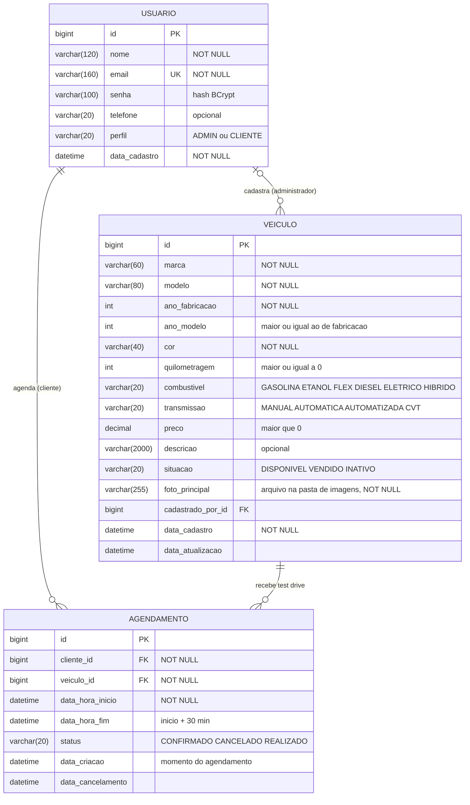
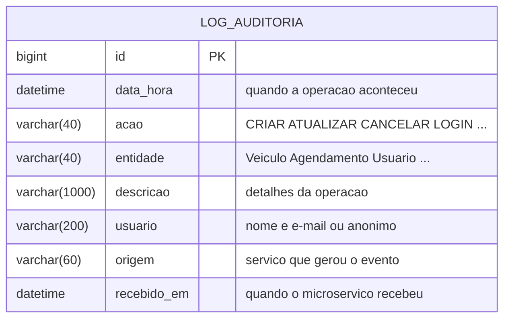

# Diagrama entidade-relacionamento (DER)

O sistema usa **dois bancos** no mesmo servidor MySQL 8.4:

- `lojacarro`: dados da loja (usuários, veículos e agendamentos), usado pela API.
- `lojacarro_logs`: logs de auditoria, usado somente pelo microserviço de logs.

Os dois são criados e versionados pelo **Flyway**: os scripts ficam em
[`src/main/resources/db/migration`](../src/main/resources/db/migration) e
[`logs-service/src/main/resources/db/migration`](../logs-service/src/main/resources/db/migration).

## Banco `lojacarro`

### Relacionamentos

| Relação | Cardinalidade | Significado |
|---|---|---|
| Usuário → Agendamento | 1 : N | Um cliente pode ter vários test drives; cada agendamento pertence a um cliente. |
| Veículo → Agendamento | 1 : N | Um veículo recebe vários test drives ao longo do tempo. |
| Usuário → Veículo | 0..1 : N | O administrador que cadastrou o veículo. |

### Restrições de integridade

| Restrição | Tabela | Regra |
|---|---|---|
| `uk_usuario_email` | usuario | E-mail único. |
| `ck_usuario_perfil` | usuario | Perfil é `ADMIN` ou `CLIENTE`. |
| `fk_veiculo_cadastrado_por` | veiculo | Referencia `usuario(id)`. |
| `ck_veiculo_preco` | veiculo | `preco > 0`. |
| `ck_veiculo_quilometragem` | veiculo | `quilometragem >= 0`. |
| `ck_veiculo_anos` | veiculo | `ano_modelo >= ano_fabricacao`. |
| `ck_veiculo_combustivel`, `ck_veiculo_transmissao`, `ck_veiculo_situacao` | veiculo | Apenas os valores válidos de cada enum. |
| `fk_agendamento_cliente`, `fk_agendamento_veiculo` | agendamento | Referenciam `usuario(id)` e `veiculo(id)`. |
| `ck_agendamento_periodo` | agendamento | `data_hora_fim > data_hora_inicio`. |
| `ck_agendamento_status` | agendamento | `CONFIRMADO`, `CANCELADO` ou `REALIZADO`. |

Índices: `veiculo (marca, modelo)`, `veiculo (situacao)`, `agendamento (veiculo_id, data_hora_inicio)` e
`agendamento (cliente_id)`, usados pelas buscas do catálogo e pela verificação de conflito de horário.

**Mecanismos contra inconsistências** além das restrições:

- **Exclusão lógica de veículos.** Desativar um veículo muda a situação para `INATIVO`, então o histórico de agendamentos é preservado.
- **Usuários com vínculos.** Usuários que cadastraram veículos ou têm agendamentos não podem ser excluídos.
- **Conflito de horário.** É verificado com bloqueio pessimista da linha do veículo (`SELECT ... FOR UPDATE`), o que impede dois agendamentos sobrepostos mesmo com pedidos simultâneos.

## Banco `lojacarro_logs` (microserviço de logs)

A tabela não tem chave estrangeira para `usuario`: o autor é guardado como texto, para o histórico continuar legível
mesmo que o usuário seja excluído, e porque os bancos dos dois serviços são independentes.
